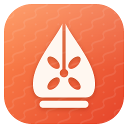
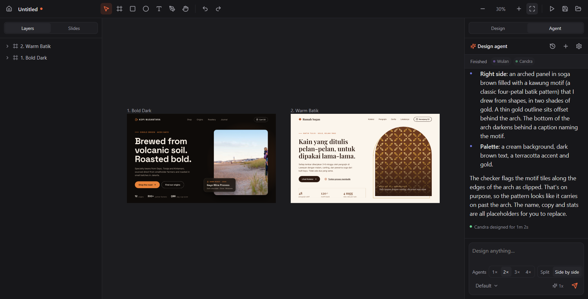
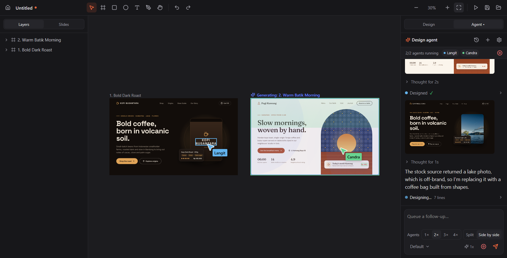
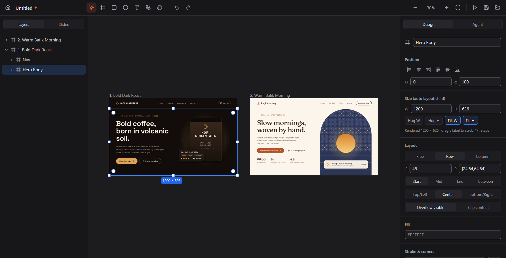
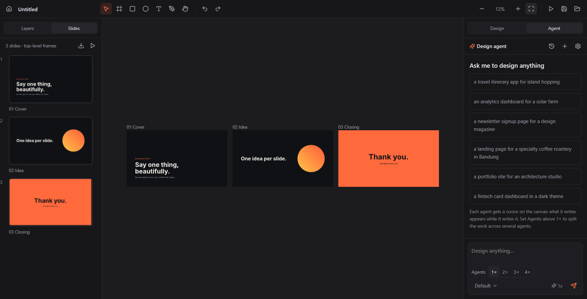
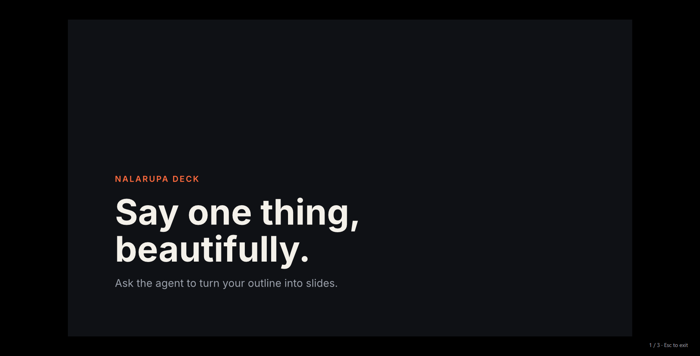
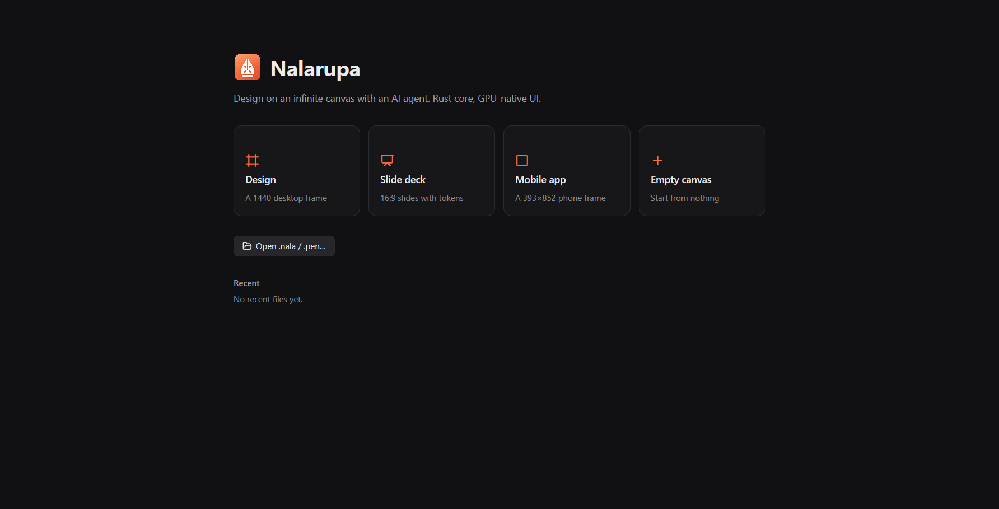

<p align="center">
  
</p>

<h1 align="center">Nalarupa</h1>

<p align="center">
  An infinite-canvas design editor with AI agents.<br>
  <b>Rust</b> core, <b>GPU-native</b> UI (GPUIX: React on top of GPUI).
</p>

<p align="center">
  <a href="https://github.com/naddrzz/nalarupa/releases/latest">Download</a> ·
  <a href="#features">Features</a> ·
  <a href="#installation">Installation</a> ·
  <a href="#development">Development</a>
</p>



*Nalarupa* comes from the Indonesian words *nalar* (reason, thought) and *rupa* (form): ideas given shape.
The logo combines a wayang *gunungan* that doubles as a pen nib (the pen tool), a *kawung* flower, and a
*parang* batik texture.

## Features

### AI design agents



- **Design chat in the right panel**: describe what you want and the agent builds it directly on the canvas.
- **Designs appear while the agent writes**: every step shows up immediately, then commits as a single undo step.
- **Agent cursors** with names and colors fly to the nodes they touch, with highlight flashes and a
  *Generating* glow on the frame being worked on.
- **1–4 parallel agents**: split the work (*Split*) or create several variants side by side (*Side by side*).
- **Let it cook**: once a design is done, the agent keeps producing variations (layout or style) on its own.
- **Model picker** (Opus 5.5, Sonnet 5.5, Haiku 5.5, Fable 5.1) and **Fast mode** where the model supports it.
- Two backends: **Claude Code** (uses your existing Claude Code login) or the **Claude API** (API key).
- Saved chat history, expandable thinking, inline screenshots, a work plan (TODO), message queue, and a
  permission card before the agent runs tools outside the canvas.
- **AI Pen**: SVG illustrations drawn progressively into a frame.

### Canvas and editor



- Infinite canvas: pan (Space, middle button, Hand), zoom (Ctrl+scroll, Shift+1 fit, Shift+2 selection).
- Frame, Rectangle, Ellipse, Text, **Pen tool** (click = corner, drag = curve, double-click to edit points).
- Selection: click → frame child, double-click → enter, Ctrl+click → deepest; marquee; Shift to add.
- 5 px **snapping** to parent and siblings with guide lines; Alt+hover measures distances.
- **Auto layout** (flexbox: Hug/Fill, gap, padding, alignment); drag inside a layout to reorder, drop on
  another frame to reparent.
- Group (Ctrl+G), duplicate (Ctrl+D, Alt-drag), align (Alt+W/A/S/D/H/V), resize keeping ratio or from the
  center, rotation, on-canvas corner radius, undo/redo, copy/paste (including text and SVG).
- **Paste from Figma**: frames, auto layout, text, vectors, components and variables come along.
- **Layers**: rename, drag to reorder or reparent, hide, hover highlights on the canvas.
- **Inspector**: position, size, layout, text, fill, stroke, radius, effects (shadow, blur), components;
  drag a label to scrub a value, ↑/↓ for small steps.
- Fills: color, gradients, **mesh gradients**, images, **shaders** (GLSL), icons (Lucide, Feather, Material
  Symbols, Phosphor), and Google Fonts downloaded once and cached.
- Components and instances, variables and themes, and **script** nodes that generate designs from JavaScript.

### Slides and presenting



- Every top-level frame is a slide; the **Slides** tab shows thumbnails and their order.
- Full-screen **Present mode** with keyboard navigation.
- Export a whole deck to **one multi-page PDF** (text stays selectable).



### Export and integrations

- Export nodes to **PNG, JPEG, WebP, SVG, HTML+CSS**, and decks to **PDF**.
- Built-in **MCP server** (`http://127.0.0.1:47700/mcp`) for external agents: Claude Code, Cursor, Codex.
  The *Connect* button writes their config only when you click it.
- Headless `nalarupa-cli` for rendering and exporting without the UI.
- `.nala` document format (readable JSON); `.pen` documents open too.

### Accessibility

- Every control is reachable with Tab and works with Enter/Space, with a clear focus ring.
- Every control has a screen-reader name (Windows UI Automation / Narrator).
- Text contrast meets WCAG AA; animations stop when the OS asks for *reduced motion*.



## Installation

**Windows 10/11 x64**

1. Download `nalarupa-windows-x64.zip` from [Releases](https://github.com/naddrzz/nalarupa/releases/latest).
2. Extract it to any folder (for example `%LOCALAPPDATA%\Programs\Nalarupa`). Keep the four files together:
   `nalarupa.exe`, `nalarupa_core.dll`, `gpuix-native.win32-x64-msvc.node`, `nalarupa.ico`.
3. Run `nalarupa.exe`.

For the AI agents, install and sign in to [Claude Code](https://claude.com/claude-code) (`claude` on your
PATH), or enter an Anthropic API key in the agent settings. App data (settings, chat history, font cache)
lives in `%LOCALAPPDATA%\Nalarupa`.

macOS and Linux can run from source (see below); release binaries are Windows-only for now.

## Development

Requirements: [Rust](https://rustup.rs) stable and [Bun](https://bun.sh) ≥ 1.3.

```bash
cd core && cargo build --release
```

```bash
cd app && bun install && bun run dev
```

`bun run dev` opens the window with hot reload (`bun --hot app.tsx`); `bun run start` runs it without.

### Building the binary

```bash
cd app && bun run build
```

The output goes to `app/dist/`: `nalarupa.exe` with the Nalarupa icon, `nalarupa_core.dll`, the GPUI addon,
and `nalarupa.ico`. For a release, zip those four files.

### Architecture

```
app/  (Bun + @gpuix/react)                core/  (Rust, nalarupa_core.dll)
┌──────────────────────────────┐  bun:ffi  ┌───────────────────────────────────────────────┐
│ Home · Editor · Present      │──────────▶│ nr_call(json) → json   nr_render(...) → RGBA  │
│ Layers/Slides · Inspector    │           │ doc.rs      document model (lossless)         │
│ Agent chat · Canvas ()  │◀── RGBA ──│ resolve.rs  components/refs, variables+themes │
│ setImagePixels per frame     │           │ layout.rs   flexbox auto layout               │
└──────────────────────────────┘           │ text.rs     rustybuzz + UAX #14, Google Fonts │
                                           │ svg.rs → usvg 0.47 → raster.rs (vello_cpu)    │
 Claude Code / Cursor / Codex              │ render.rs   view cache + dirty rect + culling │
   ── HTTP MCP 127.0.0.1:47700/mcp ───────▶│ script.rs   `execute` in QuickJS-NG (rquickjs)│
                                           │ editor.rs   snap, marquee, layout, pen tool   │
                                           │ mcp.rs      MCP streamable-HTTP + installer   │
                                           │ agent.rs    Claude API loop │ Claude Code CLI │
                                           │ html.rs     HTML+CSS export, PDF (krilla 0.8) │
                                           └───────────────────────────────────────────────┘
```

The agent guides live in `core/guide/*.md` (document schema, the `execute` API, components, slides, design,
code).

### Checks

```bash
cd core && cargo test
```

```bash
cd app && bun run typecheck && bun run smoke && bun run e2e
```

```bash
cd app && bun run editor-check && bun run editor-e2e
```

```bash
cd app && bun run mcp-check && bun run doc-check && bun run file-e2e
```

```bash
cd app && bun run script-check && bun run chat-check && bun run mcp-install-check
```

```bash
cd app && bun run drag-check && bun run viewport-check && bun run issues-check
```

```bash
cd app && bun run layout-check && bun run text-check && bun run scriptnode-check
```

```bash
cd app && bun run shader-check && bun run paint-check && bun run component-check
```

`text-check` depends on the installed fonts and runs only in the Linux CI job for now.

```bash
cd app && bun run a11y-check && bun run motion-check && bun run window-check
```

- `e2e` opens a GPU window in the background: Home → slides template → drawing → an external agent adds a
  slide over MCP → Present.
- `editor-e2e` tests editor interactions (snapping, marquee, group, auto layout, rename, pen tool).
- `mcp-check` covers the MCP HTTP contract external agents rely on (status codes, foreign-origin guard,
  JSON-RPC errors, every tool); `doc-check` covers save/open round trips, exports, variables, settings and
  edit commands; both run without a window in a throwaway data folder. `file-e2e` saves and reopens through
  the window (toolbar Save → Home → Recent).
- `script-check` covers the agent `execute` API (Copy, Update, Replace, Move, Delete, Get, variables,
  FindEmptySpace, rollback and editId repair); `chat-check` covers the saved chat history (list, load, delete,
  clear, the 20-day expiry and the running-agent guards); `mcp-install-check` covers "connect an agent" (Cursor,
  Codex and Claude Code config) against a throwaway home. All three run without a window; `mcp-install-check`
  is skipped on Windows.
- `drag-check` covers the canvas drag gestures (`drag_begin` / `drag_end`: a move, resize, rotate or pen drag is one
  undo step, an unchanged drag none); `viewport-check` covers the camera the agent is told about (`[user visible]` /
  `[outside viewport]` marks and visible-first order in the editor state); `issues-check` covers the feedback after an
  `execute` call (the "Issues detected" warnings, `Generate` errors, `Export` and `TakeScreenshot` lines). All three run
  without a window.
- `layout-check` covers auto layout as the document is edited (gap, padding, alignment, `fill_container`,
  `fit_content`, absolute children, reorder, delete, undo, save and reopen); `text-check` covers text sizing
  (`textGrowth`, line height, letter spacing, wrapping, re-measuring after an edit, font fallback);
  `scriptnode-check` covers script nodes (inputs and their clamping, re-running on a new input or size, the
  error shown in the node, children never saved). All three run without a window; `text-check` is Linux-only for
  now (it depends on the installed fonts).
- `shader-check` covers shader fills (`.glsl` uniforms and their defaults, `@resolution`, `@sdf`, opacity, an edited
  file, the red hatch for a missing or broken file, save and reopen); `paint-check` covers fills and strokes read
  back as pixels (image modes, mesh, linear, radial and angular gradients, stacked and blended fills, stroke
  alignment); `component-check` covers instances (root and `descendants` overrides, `enabled: false`, a replacing
  `type`, component edits reaching instances, nested instances, undeletable instance children, a deleted
  component). All three run without a window; `shader-check` needs a Vulkan device (lavapipe on CI).
- `a11y-check` reads the Windows UI Automation tree and fails on any unnamed control; `motion-check` makes
  sure animations stop under *reduced motion*; `window-check` makes sure the window fits the screen and its
  frame carries the Nalarupa icon (`bun run window-check dist/nalarupa.exe` for the built exe).
- `exe-check` runs the built binary; `model-check` runs two real agent turns.
- On a Linux server without a display, prefix each windowed check (`e2e`, `editor-e2e`, `file-e2e`) with
  `bash scripts/wl-run.sh` from `app/`, e.g. `cd app && bash scripts/wl-run.sh bun run file-e2e`, to run the window under a headless
  Wayland compositor (needs `sway`, `grim`, `mesa-vulkan-drivers`). CI does this on GitHub-hosted Ubuntu, and also runs the Windows-only checks on a Windows runner.
- `bun run shots` regenerates the README screenshots in `docs/screenshots/`.

Canvas performance:

```bash
cd core && cargo run --release --example bench -- file.nala 1600 1000
```

The logo lives in `app/assets/brand/` (`nalarupa.svg`, plus `nalarupa-small.svg` for 16–48 px). Regenerate
the PNGs and `nalarupa.ico` with:

```bash
cd core && cargo run --release --example icon -- ../app/assets/brand/nalarupa.svg ../app/assets/brand/nalarupa-small.svg ../app/assets/brand
```

## Connecting external agents

While the app is running, MCP is available at `http://127.0.0.1:47700/mcp` (the next port if that one is
taken). Tools: `get_editor_state`, `read_guide`, `get_style`, `execute`, `open_document`. With Claude Code:

```bash
claude mcp add --transport http --scope user nalarupa http://127.0.0.1:47700/mcp
```

## Known limitations

- Background blur in exports (through resvg) only blurs content of the same top-level frame.
- `execute` is limited to 30 s, 64 MB of memory and a 512 KB stack.
- The system clipboard is Windows-only; on macOS/Linux copy/paste works only inside the app.
- AI/stock image generation inserts placeholder photos; there is no image generation backend yet.
- PDF export uses krilla 0.8: 1 px = 1 pt, and filters (blur, shadows) are embedded as bitmaps.
- WebP is always lossless; JPEG has no alpha (transparent areas become white).
- The Claude API key is stored as-is in `%LOCALAPPDATA%\Nalarupa\settings.json`.

## License

[MIT](LICENSE). `core/vendor/resvg` is resvg 0.47.0 (Apache-2.0 OR MIT) with two *layer clamp* fixes; UI
icons are from [Lucide](https://lucide.dev) (ISC, `app/assets/icons/LICENSE`).
