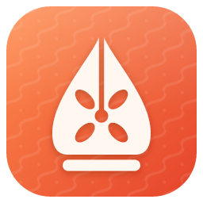
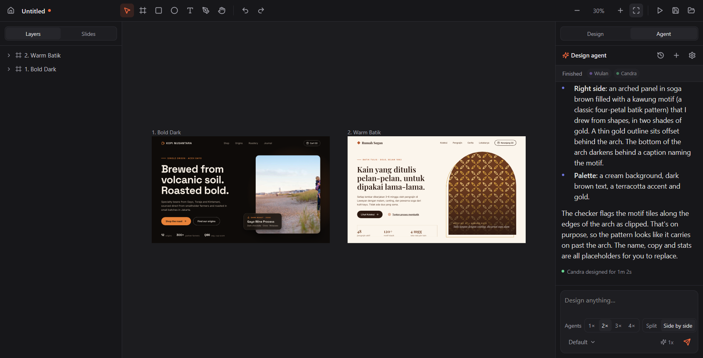
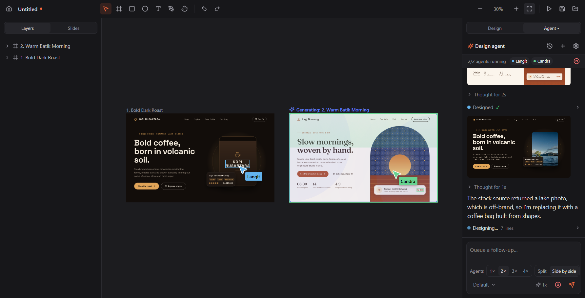
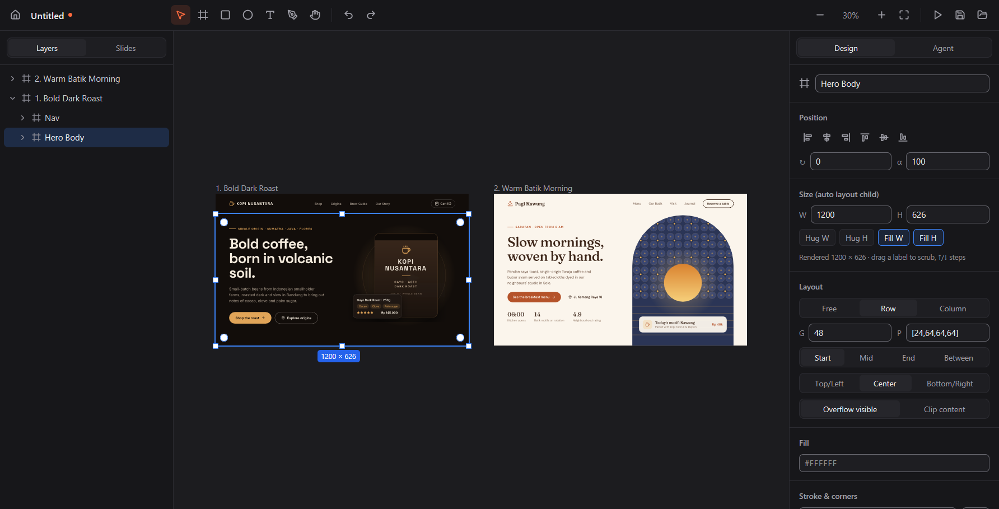
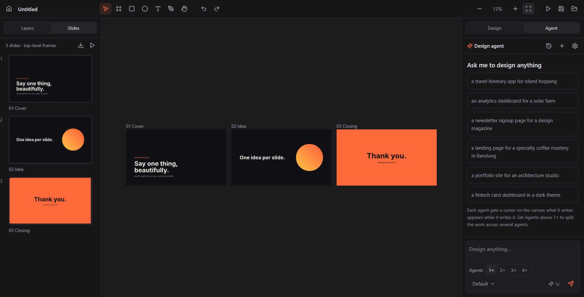
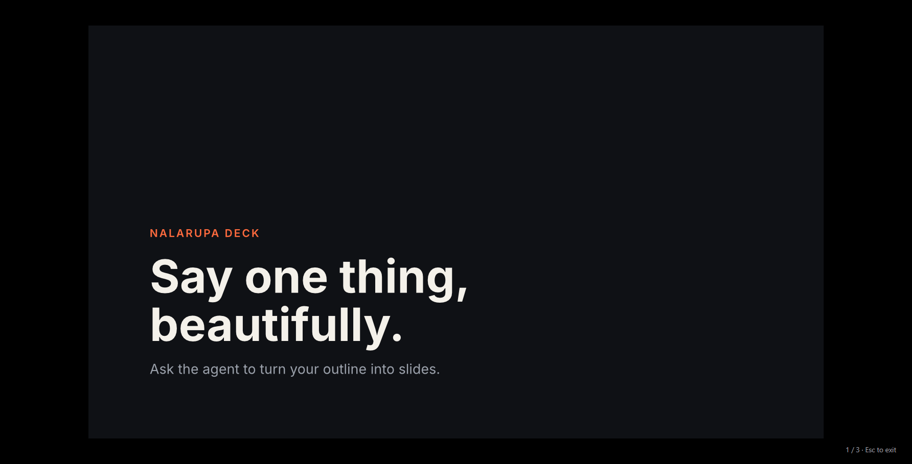
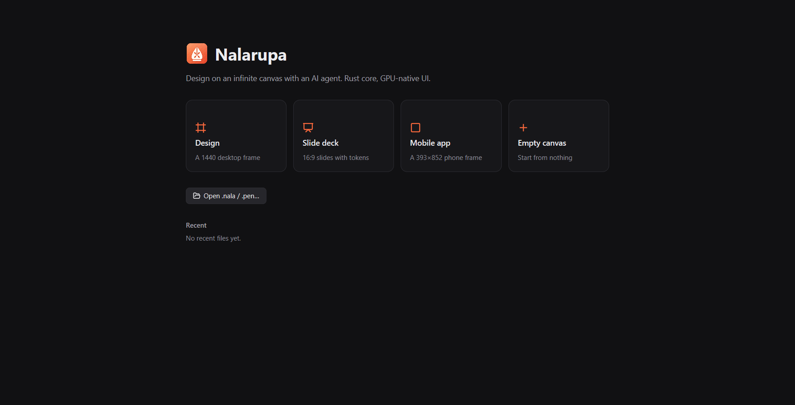

<p align="center">
  
</p>

<h1 align="center">Nalarupa</h1>

<p align="center">
  An infinite-canvas design editor with AI agents.<br>
  <b>100% Go</b>: Go core + GPU-native UI (<a href="https://mygo.run/">MyGo</a>).
</p>

<p align="center">
  <a href="https://github.com/naddrzz/nalarupa/releases/latest">Download</a> ·
  <a href="#features">Features</a> ·
  <a href="#installation">Installation</a> ·
  <a href="#development">Development</a>
</p>



*Nalarupa* comes from the Indonesian words *nalar* (reason, thought) and *rupa* (form): ideas given shape.
The logo combines a wayang *gunungan* that doubles as a pen nib (the pen tool), a *kawung* flower, and a
*parang* batik texture.

## Features

### AI design agents



- **Design chat in the right panel**: describe what you want and the agent builds it directly on the canvas.
- **Designs appear while the agent writes**: every step shows up immediately, then commits as a single undo step.
- **Agent cursors** with names and colors fly to the nodes they touch, with highlight flashes and a
  *Generating* glow on the frame being worked on.
- **1–4 parallel agents**: split the work (*Split*) or create several variants side by side (*Side by side*).
- **Let it cook**: once a design is done, the agent keeps producing variations (layout or style) on its own.
- **Model picker** (Opus 5.5, Sonnet 5.5, Haiku 5.5, Fable 5.1) and **Fast mode** where the model supports it.
- Two backends: **Claude Code** (uses your existing Claude Code login) or the **Claude API** (API key).
- Saved chat history, expandable thinking, inline screenshots, a work plan (TODO), message queue, and a
  permission card before the agent runs tools outside the canvas.
- **AI Pen**: SVG illustrations drawn progressively into a frame.

### Canvas and editor



- Infinite canvas: pan (Space, middle button, Hand), zoom (Ctrl+scroll, Shift+1 fit, Shift+2 selection).
- Frame, Rectangle, Ellipse, Text, **Pen tool** (click = corner, drag = curve, double-click to edit points).
- Selection: click → frame child, double-click → enter, Ctrl+click → deepest; marquee; Shift to add.
- 5 px **snapping** to parent and siblings with guide lines; Alt+hover measures distances.
- **Auto layout** (flexbox: Hug/Fill, gap, padding, alignment); drag inside a layout to reorder, drop on
  another frame to reparent.
- Group (Ctrl+G), duplicate (Ctrl+D, Alt-drag), align (Alt+W/A/S/D/H/V), resize keeping ratio or from the
  center, rotation, on-canvas corner radius, undo/redo, copy/paste (including text and SVG).
- **Paste from Figma**: frames, auto layout, text, vectors, components and variables come along.
- **Layers**: rename, drag to reorder or reparent, hide, hover highlights on the canvas.
- **Inspector**: position, size, layout, text, fill, stroke, radius, effects (shadow, blur), components;
  drag a label to scrub a value, ↑/↓ for small steps.
- Fills: color, gradients, **mesh gradients**, images, **shaders** (GLSL), icons (Lucide, Feather, Material
  Symbols, Phosphor), and Google Fonts downloaded once and cached.
- Components and instances, variables and themes, and **script** nodes that generate designs from JavaScript.

### Slides and presenting



- Every top-level frame is a slide; the **Slides** tab shows thumbnails and their order.
- Full-screen **Present mode** with keyboard navigation.
- Export a whole deck to **one multi-page PDF** (text stays selectable).



### Export and integrations

- Export nodes to **PNG, JPEG, WebP, SVG, HTML+CSS**, and decks to **PDF**.
- Built-in **MCP server** (`http://127.0.0.1:47700/mcp`) for external agents: Claude Code, Cursor, Codex.
  The *Connect* button writes their config only when you click it.
- Headless `nalarupa-cli` for rendering and exporting without the UI (`render`, `svg`, `html`, `exec`, `bench`, `icon`,
  `mcp`; build it with `bash build.sh` in `core-go/`, after `go generate ./shader/gpu` and with MinGW gcc as `CC`
  on Windows, see Development).
- `.nala` document format (readable JSON); `.pen` documents open too.

### Accessibility

- Every control is reachable with Tab and works with Enter/Space, with a clear focus ring.
- Every control has a screen-reader name (Windows UI Automation / Narrator).
- Text contrast meets WCAG AA; animations stop when the OS asks for *reduced motion*.



## Installation

Download the files for your system from [Releases](https://github.com/naddrzz/nalarupa/releases/latest)
(`<version>` is the release number, e.g. `0.1.0`).

**Windows 10/11 x64:** run `Nalarupa-<version>-windows-x64-setup.exe`. It installs for all users, with Start menu
and desktop shortcuts and an uninstaller. Or extract `Nalarupa-<version>-windows-x64-portable.zip` to any folder,
keeping its files together, and run `nalarupa.exe`.

**macOS 13+ (Apple Silicon):** open `Nalarupa-<version>-macos-arm64.dmg` and drag Nalarupa to Applications. A release
that is not notarized (its notes say so) is blocked by macOS the first time you open it: try to open Nalarupa once,
then open System Settings > Privacy & Security and click **Open Anyway** next to it, or run
`xattr -dr com.apple.quarantine /Applications/Nalarupa.app` in Terminal.

**Linux x64:** unpack `Nalarupa-<version>-linux-x64.tar.gz`, `cd Nalarupa-<version>-linux-x64`, and run
`./install.sh` (it installs into `~/.local`; `./install.sh --uninstall` removes it), or run `./nalarupa` in place.
It needs a Wayland session and Vulkan drivers.

For the AI agents, install and sign in to [Claude Code](https://claude.com/claude-code) (`claude` on your
PATH), or enter an Anthropic API key in the agent settings. App data (settings, chat history, font cache)
lives in `%LOCALAPPDATA%\Nalarupa` on Windows, `~/Library/Application Support/Nalarupa` on macOS and
`${XDG_DATA_HOME:-~/.local/share}/Nalarupa` on Linux.

## Development

Requirements: [Go](https://go.dev) (the version in `app/go.mod`) and a C compiler for cgo (MinGW-w64 gcc on Windows,
set as `CC`; on Linux, GTK3 development headers `libgtk-3-dev` and Vulkan drivers).

```bash
cd core-go && go generate ./shader/gpu
```

`go generate` fetches the pinned `wgpu-native` static archive once. To build the headless CLI into `core-go/out/`:

```bash
cd core-go && CGO_ENABLED=1 bash build.sh
```

To run the desktop UI during development (with live rebuilds via [MyGo](https://mygo.run/)):

```bash
cd app && CGO_ENABLED=1 go tool mygo dev
```

### Building the binary

```bash
cd app && bash build.sh
```

(On Windows, run `powershell -File build.ps1` in `app/`.) The output goes to `app/dist/`: a single standalone
executable `nalarupa.exe` (or `nalarupa`) with `core-go` linked directly in-process, `THIRD_PARTY_NOTICES.md`, and
(on Windows) `nalarupa.ico`. Set `NALARUPA_RELEASE=1` on Unix to strip the `MYGO_AUTOMATION` test plugin.

To build local release packages, first stamp the version (`sh packaging/set-version.sh <X.Y.Z>`) and run
`cd app && NALARUPA_RELEASE=1 bash build.sh` (`build.ps1` on Windows), then package for your platform:

- **Windows (NSIS installer + portable zip):**
  ```powershell
  makensis -V2 "-DVERSION=<X.Y.Z>" "-DDIST=$PWD\app\dist" "-DOUT=$PWD\out\Nalarupa-<X.Y.Z>-windows-x64-setup.exe" packaging\windows\installer.nsi
  Compress-Archive -Path app\dist\* -DestinationPath "out\Nalarupa-<X.Y.Z>-windows-x64-portable.zip"
  ```
- **macOS (Apple Silicon `.app` + `.dmg`, see [docs/release-signing.md](docs/release-signing.md) for signing and notarization):**
  ```bash
  VERSION=<X.Y.Z>
  mkdir -p out/Nalarupa.app/Contents/MacOS out/Nalarupa.app/Contents/Resources
  cp app/dist/* out/Nalarupa.app/Contents/MacOS/
  sed "s/@VERSION@/$VERSION/g" packaging/macos/Info.plist > out/Nalarupa.app/Contents/Info.plist
  icon_tmp=$(mktemp -d) && {
    set="$icon_tmp/Nalarupa.iconset"
    mkdir -p "$set"
    for s in 16 32 128 256 512; do
      cp "app/assets/brand/icon-$s.png" "$set/icon_${s}x${s}.png"
      cp "app/assets/brand/icon-$((s * 2)).png" "$set/icon_${s}x${s}@2x.png"
    done
    iconutil -c icns "$set" -o out/Nalarupa.app/Contents/Resources/Nalarupa.icns
    rm -rf -- "$icon_tmp"
  }
  codesign --force --deep --sign - out/Nalarupa.app
  stage=$(mktemp -d) && {
    cp -R out/Nalarupa.app "$stage/" && ln -s /Applications "$stage/Applications"
    hdiutil create -volname "Nalarupa $VERSION" -srcfolder "$stage" -format UDZO -ov "out/Nalarupa-$VERSION-macos-arm64.dmg"
    rm -rf -- "$stage"
  }
  ```
- **Linux (x64 tarball):**
  ```bash
  VERSION=<X.Y.Z>
  name="Nalarupa-$VERSION-linux-x64"
  mkdir -p "out/$name"
  cp app/dist/* "out/$name/"
  cp app/assets/brand/icon-256.png "out/$name/nalarupa.png"
  cp packaging/linux/nalarupa.desktop packaging/linux/install.sh "out/$name/"
  chmod +x "out/$name/install.sh" "out/$name/nalarupa"
  tar -C out -czf "out/$name.tar.gz" "$name"
  ```

### Architecture

```
┌───────────────────────────────────────────────────────────────────────────────┐
│ single Go binary (`app/` + `core-go/` linked in-process)                      │
│                                                                               │
│  app/  (MyGo Native UI: github.com/egoist/mygo/ui)                            │
│  ┌──────────────────────────────┐  direct   ┌───────────────────────────────┐ │
│  │ Home · Editor · Present      │─── Go ───▶│ engine.Dispatch / Render      │ │
│  │ Layers/Slides · Inspector    │           │ doc/     document model       │ │
│  │ Agent chat · Canvas (*Bitmap)│◀─ RGBA8 ──│ resolve/ components & tokens  │ │
│  │ Vector & AgentLayer overlays │           │ layout/  flexbox auto layout  │ │
│  └──────────────────────────────┘           │ text/    go-text + UAX #14    │ │
│                                             │ svg/ → usvg/ → resvg/ + skia/ │ │
│  Claude Code / Cursor / Codex               │ render/  view cache + culling │ │
│    ── HTTP MCP 127.0.0.1:47700/mcp ────────▶│ script/  QuickJS-NG (cgo)     │ │
│                                             │ shader/  GLSL on wgpu-native  │ │
│                                             │ editor/  snap, marquee, pen   │ │
│                                             │ agent/   MCP, Claude API/CLI  │ │
│                                             │ html/ pdf/ HTML+CSS & PDF     │ │
│                                             └───────────────────────────────┘ │
└───────────────────────────────────────────────────────────────────────────────┘
```

The agent guides live in `core-go/guide/md/*.md` (document schema, the `execute` API, components, slides, design,
code), embedded into the Go core at build time.

### Checks

```bash
cd core-go && CGO_ENABLED=1 go vet ./... && CGO_ENABLED=1 go test ./...
```

```bash
cd app && CGO_ENABLED=1 go tool mygo vet . && CGO_ENABLED=1 go vet ./... && CGO_ENABLED=1 go test ./...
```

On a Linux server without a display, run the real OS-windowed E2E suite inside a private headless Wayland compositor
(needs `sway`, `grim`, `mesa-vulkan-drivers`):

```bash
cd app && bash scripts/wl-run.sh env NALARUPA_E2E=1 CGO_ENABLED=1 go test -v -run TestRealE2E .
```

- `core-go` tests cover the document model, layout, text shaping, SVG/Skia rendering, shaders, scripts, Figma import,
  HTML/PDF exports, MCP tools, and agent loop parity.
- `app` unit & `ui.Tester` suites (`geometry_pen_test.go`, `agent_store_test.go`, `checks_test.go`, `ui_test.go`)
  cover 2D affine/Bézier geometry, the reactive agent store, MCP HTTP Origin guards & batches, client MCP installation
  in a throwaway `HOME`, shader/script/component rendering, lock-freedom during exports, full WAI-ARIA accessibility
  audits (`AccessAll` zero-unnamed-control check across views), and *reduced motion* behavior.
- `TestRealE2E_*` (`e2e_test.go`) builds `app/dist/nalarupa`, launches a real OS window via `MYGO_AUTOMATION`, drives
  Home → Slides/Design/Mobile/Empty templates → Canvas drawing & Pen tool → live HTTP MCP `execute` → Presentation
  mode → Save/Recent/Unsaved guard → live streaming `claude` agent, and verifies real window PNG captures.
- `cmd/design-eval` measures the design agent: `cd app && CGO_ENABLED=1 go run ./cmd/design-eval run` sends eight fixed
  eval briefs through the agent and keeps the eval run (PNGs, documents, transcripts, `metrics.json`, `summary.md`; by
  default in `~/nalarupa-eval/`), and `CGO_ENABLED=1 go run ./cmd/design-eval compare <runA> <runB>` compares two eval
  runs side by side and flags sameness across unrelated briefs.
- `cd app && CGO_ENABLED=1 go run ./cmd/shots` regenerates the README screenshots in `docs/screenshots/` using a fresh
  temporary `NALARUPA_DATA`.

Canvas performance (`bash build.sh` in `core-go/` first):

```bash
./core-go/out/nalarupa-cli bench file.nala 1600 1000
```

The logo lives in `app/assets/brand/` (`nalarupa.svg`, plus `nalarupa-small.svg` for 16–48 px). Regenerate
the PNGs and `nalarupa.ico` with:

```bash
./core-go/out/nalarupa-cli icon app/assets/brand/nalarupa.svg app/assets/brand/nalarupa-small.svg app/assets/brand
```

## Connecting external agents

While the app is running, MCP is available at `http://127.0.0.1:47700/mcp` (the next port if that one is
taken). Tools: `get_editor_state`, `read_guide`, `get_style`, `execute`, `open_document`. With Claude Code:

```bash
claude mcp add --transport http --scope user nalarupa http://127.0.0.1:47700/mcp
```

## Known limitations

- Background blur in exports (through resvg) only blurs content of the same top-level frame.
- `execute` is limited to 30 s, 64 MB of memory and a 512 KB stack.
- AI/stock image generation inserts placeholder photos; there is no image generation backend yet.
- PDF export (`core-go/pdf`): 1 px = 1 pt, and filters (blur, shadows) are embedded as bitmaps.
- WebP is always lossless; JPEG has no alpha (transparent areas become white).
- The Claude API key is stored as-is in `settings.json` inside the user app-data folder.

## License

[MIT](LICENSE). Full third-party copyright notices and license texts (including the Go ports of resvg 0.47.0,
usvg 0.47.0, tiny-skia 0.12, unicode-linebreak, QuickJS-NG, [MyGo](https://mygo.run/), purego, and
[Lucide](https://lucide.dev) icons) are preserved in [THIRD_PARTY_NOTICES.md](THIRD_PARTY_NOTICES.md) and shipped
alongside packaged builds.
